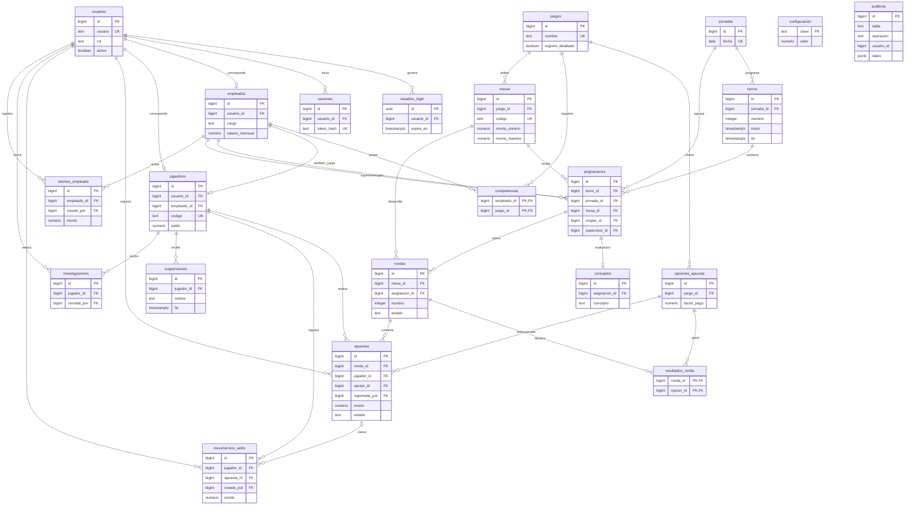

# Modelo de datos del casino

## 1. Propósito y fuente

El modelo permite administrar usuarios, empleados, competencias, mesas, turnos, rondas, apuestas, movimientos de saldo y prevención de riesgo. La fuente de verdad del esquema es `db/02_esquema.sql`, complementado por `db/20_personal_mesas.sql`, `db/30_rondas_apuestas.sql` y `db/40_riesgo_historial.sql`.

Se utiliza **PostgreSQL 16**, con los objetos de aplicación en el esquema `casino`. El modelo consta de **22 tablas**, identificadores y claves foráneas, restricciones declarativas, índices y lógica de negocio en PL/pgSQL. Las vistas `v_*` representan consultas de lectura; no son tablas físicas ni se duplican datos en ellas.

## 2. Diagrama entidad-relación

El diagrama recoge todas las tablas de negocio y las relaciones declaradas mediante claves foráneas. En `auditoria` no hay FK por decisión de diseño: la bitácora mantiene el registro incluso si cambian o se eliminan datos de otras tablas.

**Lectura:** `PK` identifica una clave primaria, `FK` una clave foránea y `UK` un atributo con unicidad. Los campos mostrados son una selección para facilitar la lectura; la definición íntegra está en `02_esquema.sql`. La relación `apuestas` → `movimientos_saldo` admite una FK opcional (`apuesta_id` puede ser nulo para consignaciones y retiros). Las dos relaciones entre `empleados` y `asignaciones` corresponden a los papeles independientes de crupier y supervisor.

## 3. Diccionario resumido de tablas

| Área | Tablas | Función |
|---|---|---|
| Acceso | `usuarios`, `desafios_login`, `sesiones` | Identidad, desafío de autenticación SRP y sesiones. |
| Catálogo y personal | `juegos`, `opciones_apuesta`, `empleados`, `competencias`, `mesas` | Juegos, cuotas, personas autorizadas y límites de apuesta. |
| Operación | `jornadas`, `turnos`, `asignaciones`, `conceptos` | Programación, rotación y evaluación subjetiva del crupier. |
| Juego | `jugadores`, `rondas`, `resultados_ronda`, `apuestas` | Cuentas de jugadores y liquidación de rondas. |
| Finanzas y riesgo | `movimientos_saldo`, `configuracion`, `suspensiones`, `investigaciones`, `abonos_empleado` | Trazabilidad de fichas, umbral, autoexclusión e investigación. |
| Trazabilidad | `auditoria` | Registro de cambios en entidades sensibles. |

## 4. Correspondencia entre reglas y mecanismos SQL

| Regla | Mecanismo de cumplimiento | Archivo |
|---|---|---|
| Usuario único, rol válido y usuario activo | `UNIQUE`, `CHECK` en `usuarios`; funciones de sesión y control de rol | `02`, `05`, `10` |
| Una cuenta de jugador por usuario y código de cliente único | `UNIQUE` y secuencia `seq_codigo_jugador` | `02` |
| Jugador mayor de edad y documento numérico de 6 a 12 dígitos | Trigger `tg_validar_jugador`; errores `CA304`/`CA309` | `40` |
| Empleado asociado a una cuenta cuyo rol coincide con su cargo | Trigger `tg_empleado_rol` | `20` |
| Mesa con mínimo positivo y máximo no menor al mínimo | `CHECK` en `mesas`; funciones de gestión | `02`, `20` |
| Turno mayor a 0 y máximo de dos horas | `CHECK` de fechas y `tg_validar_turno` | `02`, `20` |
| Turnos de una jornada sin superposición | Trigger `tg_validar_turno` (`CA111`) | `20` |
| Una mesa y un crupier por turno; rotación del crupier por jornada | Tres restricciones `UNIQUE` de `asignaciones` | `02`, `20` |
| Crupier y supervisor activos y competentes para el juego | Trigger `tg_validar_asignacion` | `20` |
| Concepto del supervisor solo al terminar y una vez | `UNIQUE(asignacion_id)` y `tg_validar_concepto` | `02`, `20` |
| Ronda correlativa por mesa y una sola ronda abierta | Trigger `tg_rondas_antes_insertar` e índice único parcial | `02`, `30` |
| Apuesta con monto permitido, opción válida y jugador autorizado | `tg_apuestas_antes_insertar`, `fn_puede_apostar` y validación de saldo | `30`, `40`, `05` |
| Saldo nunca negativo y movimientos trazables | `CHECK(saldo >= 0)` y `fn_mover_saldo` con bloqueo de fila | `02`, `05` |
| Cierre de ronda con resultado y premios | `fn_cerrar_ronda`, movimientos `devolucion` y `premio` | `30` |
| Suspensión por umbral diario y pausa voluntaria | `fn_evaluar_riesgo`, `fn_solicitar_pausa`, vistas derivadas | `40` |
| Empleado suspendido si la deuda supera dos salarios | `fn_evaluar_riesgo`; índice único parcial para suspensión de deuda activa | `02`, `40` |
| Levantamiento de suspensión tras abono | `fn_registrar_abono` y reevaluación de riesgo | `40` |
| Investigación por ganancia superior al salario | `fn_evaluar_riesgo`; índice único parcial de investigación abierta | `02`, `40` |
| Escritura solo a través de funciones autorizadas | `SECURITY DEFINER`, `fn_exigir_rol`, revocación de permisos directos | `05`, `20`, `40`, `50` |
| Registro de modificaciones sensibles | `tg_auditar`, tabla `auditoria` | `50` |

## 5. Consultas y vistas

Las vistas del módulo de personal son `v_juegos`, `v_empleados`, `v_mesas`, `v_jornadas`, `v_turnos`, `v_asignaciones` y `v_mis_turnos_supervisor`. El módulo de riesgo expone `v_estado_jugador`, `v_jugadores`, `v_historial_apuestas`, `v_historial_movimientos`, `v_suspensiones`, `v_investigaciones`, `v_deuda_empleado` y `v_configuracion`. André aporta las vistas de rondas, apuestas y reportes.

Las acciones de Next.js consultan estas vistas y ejecutan funciones `fn_*` con parámetros. La autorización no debe depender exclusivamente de ocultar botones: también se comprueba el rol en el servidor y en la base de datos. Los valores monetarios se almacenan como `numeric(14,2)` y se manejan como cadenas en TypeScript para evitar errores de coma flotante.

## 6. Decisiones de diseño y límites actuales

- **Normalización:** empleados y jugadores son entidades distintas, relacionadas opcionalmente cuando un empleado también juega. `competencias` y `resultados_ronda` representan relaciones muchos-a-muchos. `asignaciones.jornada_id` es una redundancia controlada que permite aplicar la restricción de rotación por jornada; el trigger la sincroniza con el turno.
- **Estados derivados:** el estado de un jugador no se copia como texto persistente; lo calcula `v_estado_jugador` en este orden: Inactivo → Investigación → Suspendido → Activo.
- **Deuda y pérdidas:** el código del módulo 40 implementa actualmente la fórmula *pérdidas menos premios* prevista en el contrato del equipo. La especificación de requerimientos original define las pérdidas diarias como suma de apuestas perdidas. La interpretación debe acordarse con los tres integrantes antes de considerarla definitiva.
- **Verificación integral:** la primera ejecución del 2 de noviembre dio 39 `OK` y dos fallos por documentos alfanuméricos. André corrigió esos tests y ajustó los permisos; tras incorporar `main` en `andres/backend`, Andrés confirmó localmente **109 `OK`, 0 `FALLO`, 0 `PENDIENTE`**. Ocho permisos de funciones públicas revisados devolvieron `t`. Ver `docs/pruebas/estado-integracion.md`.
- **Pendiente de acuerdo:** la especificación del grupo prohíbe apostar a empleados durante su turno y cerrar una investigación propia. Estas comprobaciones no deben darse por implementadas sin pruebas específicas.

## 7. Evidencia para la sustentación

Para comprobar el funcionamiento, mostrar: consultas de relaciones y claves, creación de una mesa válida, rechazo del mínimo mayor al máximo, turno de máximo dos horas, rechazo de doble asignación y de rotación, competencia incompatible, concepto antes de tiempo, suspensión por pérdidas, abono y levantamiento de suspensión, investigación y acceso al historial. Usar los datos de `docs/documento/datos-prueba.md`.
